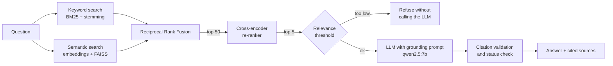

# OSFI Regulation Assistant

A retrieval-augmented generation (RAG) system that answers questions about Canadian mortgage and model-risk regulation using **only official OSFI guidelines**, with a citation to the exact section behind every statement. It refuses questions the documents can't answer.

**Stack:** Python · Hybrid search (BM25 + `bge-small-en-v1.5` embeddings, FAISS) · Cross-encoder re-ranking · Open-source LLM (`qwen2.5:7b` via Ollama) · FastAPI · pytest · Docker · GitHub Actions


---

## Why build this

LLMs answer regulatory questions confidently, but not reliably. Asked for the minimum qualifying rate on uninsured mortgages, the same 7B model **without** retrieval said it was *"the five-year Canada Prime Rate plus 0.80%"*, which is invented. **With** retrieval, it answered correctly, *"the greater of the contractual rate plus 2% or 5.25%"*, and cited the OSFI passage.

In regulated industries like banking and insurance, an answer is only useful if it can be traced to its source. This project is built around that requirement, and around **measuring** whether it's met.

## Results

Evaluated on 60 questions: 43 with a known correct passage, 7 more hand-written in-scope questions, 5 unrelated questions, and 5 near-topic questions about OSFI subjects these documents don't cover (cyber risk, liquidity, climate, life-insurer capital, outsourcing).

| Metric | Result |
|---|---|
| Correct passage in the top 5 retrieved (Hit@5) | **97.7%** |
| Mean Reciprocal Rank of the correct passage | **0.879** |
| In-scope questions answered | **100%** (50/50) |
| Answers citing the exact correct passage | **90.7%** |
| Unrelated questions refused | **100%** (5/5) |
| Near-topic questions refused | **100%** (5/5) |
| Answers judged fully supported by their passages | **92%**, with **0 unsupported** |
| Invalid citations | **0** |
| Median time per answer (T4 GPU) | **3.3 s** |

Full results: [`evaluation/`](evaluation/). The evaluation notebook is [`notebooks/osfi_rag_part4_evaluation.ipynb`](notebooks/).

## How it works



1. **Ingestion** ([Part 1](notebooks/)): six OSFI documents (Guidelines B-20, B-21 and E-23, plus a B-20 infosheet, a B-20 advisory and a mortgage-insurance implementation note) are downloaded and split into 186 chunks of about 200 words that never cross a section boundary, so each one can be cited by section.
2. **Retrieval** ([Part 2](notebooks/)): keyword search and semantic search are combined with Reciprocal Rank Fusion, then a cross-encoder re-ranks the top 50 candidates.
3. **Generation** ([Part 3](notebooks/)): the LLM answers only from the five retrieved passages and cites one after every sentence.
4. **Guardrails:** a relevance threshold refuses off-topic questions before the LLM is called. Afterwards, every citation is checked against the passages actually provided, and the response is classified as *answered*, *partial* or *refused*.
5. **Evaluation** ([Part 4](notebooks/)): retrieval and answer quality are measured on a test set, including an ablation study and an LLM-as-a-judge check.

## What went wrong, and how it was fixed

Several problems only appeared because each stage was measured.

**1. Messy source data.** The first extraction pulled in 770 rows of chart data ("Jul-15 | 25% | 22%") and pasted footnotes into the middle of sentences, because OSFI marks footnotes with a custom `<fn>` tag. Number-only table rows were filtered out, and footnotes were moved into separate passages, so their definitions stay searchable.

**2. A definition the system couldn't find.** *"How does OSFI define a model?"* was refused. The definition sits under the heading *Key Terms › Model*, but its text never repeats the word "model", while every neighbouring definition uses it repeatedly. The first fix, labelling definition passages for search, **changed nothing**. A diagnostic showed why:
- The re-ranker only saw the top **20** first-stage candidates. When the definition ranked 9th, the re-ranker moved it to **1st**, but for most phrasings it never reached the re-ranker.
- Keyword search treated *define*, *defines* and *definition* as unrelated words.

An **ablation study** added one fix at a time (hybrid search + re-ranking):

| Configuration | Hit@5 | MRR | Rank of the definition |
|---|---|---|---|
| A. Original | 0.953 | 0.868 | not reached |
| B. + definition labels | 0.953 | 0.868 | not reached |
| C. + stemming | **0.977** | **0.879** | 2 |
| D. + re-ranker pool of 50 (final) | **0.977** | **0.879** | **2** |

Stemming produced the measurable gain. The definition test was also repeated with four phrasings of the question. The definition was found for 0 of 4 phrasings originally, 1 with labels, 2 with stemming, and 3 with the larger re-ranker pool. The fourth, *"What counts as a model for OSFI?"*, still doesn't reach the re-ranker even with a pool of 50 (see Limitations).

On its own, stemming slightly *lowered* keyword search (Hit@5 0.907 → 0.884), yet it improved the full pipeline, which is why the whole system is evaluated rather than each part alone.

**3. A false regression in the evaluation itself.** After a prompt change, near-topic refusals appeared to drop from 80% to 40%, and three answers were judged "unsupported". Reading the responses showed they were all **correct refusals**: the model began with the refusal sentence but also attached citation numbers, and the status check counted them as partial answers. The rule was changed so a response that *starts* with the refusal sentence is a refusal. Real result: **100% of near-topic questions refused, 0 unsupported answers.** This case is now a unit test.

**4. Choosing the relevance threshold from data.** Unrelated questions scored −7.96 or lower, and the lowest in-scope question 0.32. Raising the threshold to catch near-topic questions would start blocking valid ones (1 in-scope question at 1.00, 3 at 2.00), while the LLM already refused all near-topic questions correctly. The threshold stays at **−1.99**: it stops unrelated questions cheaply and never blocks a valid one.

## Limitations

- **Generated test questions are optimistic.** Most test questions were written by the LLM from known passages, so they're more literal than real users' questions. Review also found one generated question that misdefined "FRFI" (it means *federally regulated financial institution*), and the model accepted the false premise.
- **The judge grades its own model.** The same LLM wrote and judged the answers, so judge scores may be lenient.
- **Similar documents can blend.** B-20 (lenders) and B-21 (mortgage insurers) use very similar language, and one answer about lenders drew on an insurer passage.
- **Paraphrases can still miss.** *"What counts as a model for OSFI?"* never reaches the definition passage, because it shares almost no words with it and the first-stage search ranks it below 50. Query rewriting or more training-style paraphrases in the test set would be the next fix.
- **Over-hedging.** About half of in-scope answers end with a note on what the passages don't cover, even when the question was fully answered.
- **Documents age.** The 2017 B-20 text predates the 2021 qualifying-rate floor of 5.25%. The assistant answered correctly because the newer infosheet was included, which shows the index needs updating when guidance changes.

## Run it

**In Google Colab (simplest):** run the notebooks in [`notebooks/`](notebooks/) in order on a T4 GPU runtime. Part 5 runs the 26 tests, builds the final index (186 passages, 13 definitions labelled) and serves the API.

**With Docker:**
```bash
python scripts/build_index.py --chunks path/to/chunks.jsonl --out index   # chunks from Part 2
docker compose up --build
docker compose exec ollama ollama pull qwen2.5:7b                         # first run only
# open http://localhost:8000/docs
```

**API example:**
```bash
curl -X POST localhost:8000/ask -H "Content-Type: application/json" \
     -d '{"question": "What is the maximum loan-to-value ratio for a HELOC?"}'
```
Returns the answer, its status (`answered`, `partial` or `refused`), the cited passage numbers, and every source with its document, section, link and relevance score. `POST /search` exposes retrieval on its own, with a choice of the four search methods.

**Example responses from the running API** (Part 5, Colab T4 GPU):

| Question | Status | Answer (shortened) | Cited section | Time |
|---|---|---|---|---|
| How does OSFI define a model in its model risk guideline? | answered | "An application of theoretical, empirical, judgmental assumptions or statistical techniques, including AI/ML methods, which processes input data to generate results." | E-23 › Key Terms › Model | 112 s* |
| What is the maximum loan-to-value ratio for a HELOC? | answered | Less than or equal to 65% for the non-amortizing HELOC component. | B-20 › LTV Ratio and Loan Type › HELOCs | 2.1 s |
| What is the minimum qualifying rate for uninsured mortgages? | answered | The greater of the contractual mortgage rate plus 2% or 5.25%. | B-20 infosheet › Impact of Guideline B-20 | 1.9 s |
| What does OSFI expect banks to do to manage cyber security risk? | refused | Not covered by these documents (correct: cyber risk is in a different guideline). | none | 1.8 s |
| What is the best recipe for banana bread? | refused | Stopped by the relevance threshold before the LLM was called. | none | 0.17 s |

\*The first request loads the embedding, re-ranking and language models. Later requests take about 2 seconds. The cyber question is the case found in the evaluation: the model added citation numbers to its refusal, and the fixed status check still classifies it correctly as a refusal.

**Tests:** `pip install -r requirements-test.txt && pytest`. 26 tests run in under a second using small stand-in models, and include regression tests for each evaluation bug above.

## Repository structure

```
osfi_rag/
  retriever.py     hybrid search: BM25 with stemming, embeddings + FAISS, rank fusion, re-ranking
  enrichment.py    labels definition passages for search
  generator.py     grounding prompt, LLM client, citation validation, answer status
  api.py           FastAPI service (/ask, /search, /health)
  service.py       loads models and index
  config.py        settings from environment variables
scripts/build_index.py   builds the final index from the chunks
tests/                   unit tests, with stand-in models
notebooks/               Parts 1-5: ingestion, retrieval, generation, evaluation, serving
evaluation/              test set, metrics, ablation chart and answers
Dockerfile, docker-compose.yml, .github/workflows/ci.yml
```

## Source documents

Content from the [Office of the Superintendent of Financial Institutions (OSFI)](https://www.osfi-bsif.gc.ca/en/guidance/guidance-library). This repository does not redistribute the documents: the Part 1 notebook downloads them from OSFI's website. This is an independent portfolio project, not affiliated with or endorsed by OSFI, and its answers are not legal or regulatory advice.
